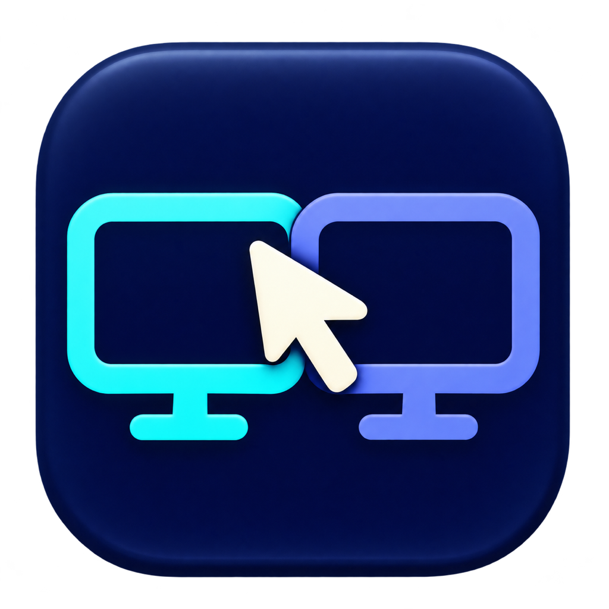

# LanKvm

用一套 Mac 键盘和鼠标操作旁边的 Windows 电脑。把指针推过屏幕边缘，键鼠就切到另一台电脑。两台机器各用自己的显示器，通过局域网同步输入和剪贴板。

## 安装独立版

从 [GitHub Releases](https://github.com/5Lee/LanKvm/releases/latest) 下载两端的安装包。

| 设备 | 安装包 | 首次设置 |
| --- | --- | --- |
| Apple 芯片 Mac（macOS 13 或更高版本） | `LanKvm-Mac-1.3.2-arm64.dmg` | 把 LanKvm 拖到「应用程序」，推出镜像，打开应用并授予辅助功能权限。 |
| Windows 10 / 11 | `LanKvm-Windows-1.3.0.zip` | 解压后以管理员身份运行一次 `install.bat` 配置专用网络防火墙。日常使用双击 `run-lankvm.bat`。 |

在 Mac 的 LanKvm 菜单栏打开「设置」，填入 Windows 接收端窗口显示的地址和配对令牌，点「保存并连接」。将 Windows 设置在 Mac 的左侧或右侧后，就可以从对应边缘跨屏。随时按 **Control + Option + Command + K** 把键鼠交还 Mac。

## 跨屏复制

- 在 Finder 或 Windows 资源管理器里复制一组文件、照片或文件夹，可以到另一台电脑粘贴。子目录、空文件夹和文件名会一起保留。
- 大文件走独立的分块传输连接，代码没有设置单次文件总大小上限。接收端要有足够临时空间。传几 GB 的文件夹时，等传输完成后再到目标文件夹粘贴。
- 也支持双向复制文字和剪贴板图片。可以从 Mac 的菜单栏关闭剪贴板同步。

配对令牌用于验证连接。键鼠和剪贴板数据通过未加密的 HTTP/TCP 传输，请在可信局域网使用。默认 TCP 端口为 `7681` 和 `7682`。

## 从源码构建和测试

- **macOS** 需要 Xcode Command Line Tools。在仓库根目录执行 `(cd app/mac && ./build.sh && ./make-dmg.sh)`，安装包生成在 `app/mac/build/LanKvm.dmg`。默认编译本机架构。
- **Windows** 在仓库中运行 `app\win\build-on-windows.bat`，使用 .NET Framework 的 C# 编译器生成 `app\win\LanKvm.exe`。
- **回归测试** 在 Mac 的仓库根目录运行 `python3 app/tests/input_checks.py` 和 `python3 app/tests/clipboard_load.py`。测试使用本机回环连接和独立的测试剪贴板。

独立版的键位映射、文件传输限制和排错步骤见[使用手册](app/README.md)。使用 DSH 的用户也可以安装仓库附带的[旧版插件](docs/dsh-plugin.md)。

## 许可证

本项目采用 [MIT 许可证](LICENSE)。
